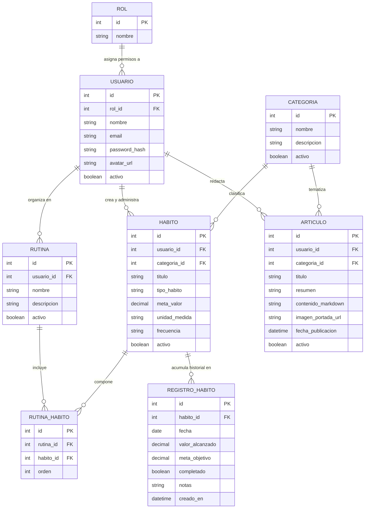

# Propuesta: Seguimiento de Hábitos y Educación

## Índice
1. [Narrativa del Proyecto y Descripción del Problema](#1-narrativa-del-proyecto-y-descripción-del-problema)
   - 1.1. [Presentación y Temática](#11-presentación-y-temática)
   - 1.2. [Descripción de la Problemática](#12-descripción-de-la-problemática)
   - 1.3. [Propuesta de Solución](#13-propuesta-de-solución)
2. [Modelo de Datos y Diagrama Entidad-Relación (DER)](#2-modelo-de-datos-y-diagrama-entidad-relación-der)
   - 2.1. [Diagrama Entidad-Relación (DER)](#21-diagrama-entidad-relación-der)
   - 2.2. [Listado y Descripción de Entidades](#22-listado-y-descripción-de-entidades)
   - 2.3. [Descripción de Relaciones no Triviales](#23-descripción-de-relaciones-no-triviales)
3. [Apéndice: Especificaciones Técnicas, Alcance y Límite](#3-apéndice-especificaciones-técnicas-alcance-y-límite)
   - 3.1. [Ficha Técnica](#31-ficha-técnica)
   - 3.2. [Alcance y Límite](#32-alcance-y-límite)
   - 3.3. [Análisis de la Competencia y Limitaciones del Mercado](#33-análisis-de-la-competencia-y-limitaciones-del-mercado)
   - 3.4. [Cumplimiento de Requerimientos de Cátedra](#34-cumplimiento-de-requerimientos-de-cátedra)
   - 3.5. [Vistas de la SPA (SvelteKit)](#35-vistas-de-la-spa-sveltekit)

---

## 1. Narrativa del Proyecto y Descripción del Problema

### 1.1. Presentación y Temática
* **Proyecto:** Seguimiento de Hábitos y Educación
* **Temática:** Registro diario de hábitos personales, gráficos de consistencia y artículos educativos.
* **Integrantes:** Angel Emanuel - emanuelangelsbr@gmail.com

### 1.2. Descripción de la Problemática
El seguimiento de hábitos personales falla habitualmente por problemas en las herramientas existentes:

1. **Fricción al registrar:** Interfaces lentas, pantallas de carga y demasiados pasos para registrar una acción de dos segundos.
2. **Dependencia del celular:** La mayoría solo funcionan como app móvil, sin una versión web ágil para usar desde la computadora mientras se trabaja.
3. **Cobros excesivos:** Suscripciones caras ($40 a $60 USD al año) que bloquean funciones básicas como ver el historial completo o cargar más de 3 hábitos.
4. **Interfaces saturadas:** Aplicaciones llenas de elementos visuales innecesarios o dinámicas de juegos de rol (vidas, oro, niveles) que distraen en lugar de ayudar.
5. **Falta de información:** Herramientas que se limitan a casillas de verificación sin explicar cómo armar o sostener hábitos según la ciencia del comportamiento.

### 1.3. Propuesta de Solución
El sistema resuelve esta problemática mediante:

1. **Acceso web multiplataforma y responsivo:** Funciona desde cualquier navegador (computadora, tablet o celular) sin necesidad de instalar aplicaciones. Permite registrar hábitos directamente desde la PC mientras se trabaja o estudia, eliminando la dependencia exclusiva del celular.
2. **Registro rápido y sin fricción:** Controles directos en la pantalla principal (botones de sí/no o contadores numéricos) que guardan el progreso al instante sin abrir formularios secundarios ni recargar la página.
3. **Visualización clara de consistencia:** Cuadrículas visuales (estilo contribuciones de GitHub) que muestran el cumplimiento semanal y anual de un vistazo, con una interfaz limpia y sin mecánicas de juego que distraigan del objetivo.
4. **Disponibilidad completa y sin costo:** Acceso gratuito y sin límites artificiales en la cantidad de hábitos ni en el historial de registros.
5. **Módulo extra de educación y fundamentación:** Módulo agregado para cumplir con los requerimientos de la cátedra (subida de imágenes de portada al servidor y funciones exclusivas para el rol Administrador), que además aporta artículos breves en Markdown sobre ciencia del comportamiento y formación de hábitos para respaldar la práctica.

---

## 2. Modelo de Datos y Diagrama Entidad-Relación (DER)

### 2.1. Diagrama Entidad-Relación (DER)

### 2.2. Listado y Descripción de Entidades

1. **`ROL` (puede ser ENUM):** Define los niveles de acceso (Administrador y Usuario).
2. **`USUARIO`:** Datos de la cuenta (nombre, email, contraseña con hash), rol asignado, estado activo y avatar guardado en el servidor.
3. **`CATEGORIA`:** Agrupa hábitos y artículos por tema (ej. Salud, Estudio, Trabajo).
4. **`HABITO`:** Regla o meta definida por el usuario (tipo cuantitativo, sí/no o abstinencia; valor meta y frecuencia).
5. **`REGISTRO_HABITO`:** Registro diario de un hábito en una fecha concreta. Guarda el valor alcanzado, la meta fija a esa fecha y si se completó.
6. **`RUTINA`:** Agrupación de hábitos para un momento del día (ej. Mañana, Noche) definida por el usuario.
7. **`RUTINA_HABITO`:** Tabla intermedia (N:M) que asocia hábitos a una rutina y define su orden de ejecución.
8. **`ARTICULO`:** Publicación en Markdown creada por administradores, vinculada a una categoría y con imagen de portada en el servidor.

### 2.3. Descripción de Relaciones no Triviales

* **`CATEGORIA` como clasificador compartido:** Permite asociar tanto hábitos como artículos a una misma categoría.
* **Restricción de fecha en `REGISTRO_HABITO`:** Restricción `UNIQUE(habito_id, fecha)` para que exista un solo registro por hábito por día. La meta queda fija en el registro para no alterar el historial si el usuario cambia su meta después.
* **`RUTINA` y `HABITO` (relación N:M vía `RUTINA_HABITO`):** Permite organizar hábitos en bloques según el momento del día. Un hábito puede pertenecer a múltiples rutinas (o a ninguna) y una rutina agrupa varios hábitos ordenados. El registro diario (`REGISTRO_HABITO`) se mantiene independiente de la rutina, vinculado directamente al hábito.
* **Dependencia de dos tablas en `ARTICULO` y `HABITO`:** `HABITO` depende de `USUARIO` y `CATEGORIA`. `ARTICULO` depende de `USUARIO` y `CATEGORIA`.

---

## 3. Apéndice: Especificaciones Técnicas, Alcance y Límite

### 3.1. Ficha Técnica

| Parámetro | Detalle |
|---|---|
| **Arquitectura** | ASP.NET Core WebAPI (.NET 10) + SPA en SvelteKit (`adapter-static`) |
| **Acceso a Datos** | ADO.NET puro (consultas SQL a mano con `MySqlConnector`, sin ORM) |
| **Base de Datos** | MySQL 8.0 |
| **Autenticación** | JWT con roles (Administrador y Usuario) |

### 3.2. Alcance y Límite

#### Alcance
* **Autenticación y Sesiones:** Registro, login con JWT y subida de avatar al servidor.
* **CRUD de Usuarios:** Alta en registro, edición de datos personales/avatar y gestión de estado por el Administrador.
* **CRUD de Categorías:** Alta, modificación, listado y baja lógica (solo Administrador).
* **CRUD de Hábitos:** Alta, edición de metas, archivado/baja lógica y listado individual por usuario.
* **CRUD de Rutinas:** Alta, edición de orden de hábitos, baja lógica y filtrado en pantalla principal.
* **CRUD de Registros de Hábitos:** Creación diaria rápida (sí/no o contador), actualización de valores o notas, consulta de historial y anulación/reinicio del día.
* **CRUD de Artículos:** Alta con editor Markdown e imagen de portada, edición, listado paginado y baja lógica (solo Administrador; lectura para usuarios autenticados).
* **Visualización de consistencia:** Cuadrícula de 7 días por tarjeta y vista histórica en detalle.
* **Paginación y búsquedas:** Paginación en servidor para historial y catálogo de artículos; búsqueda asíncrona para asociar categorías a hábitos y artículos.

#### Límite
* No es offline ni tiene app móvil nativa.
* Sin integración con calendarios externos (Google Calendar).
* Sin notificaciones push ni temporizadores en tiempo real.

### 3.3. Análisis de la Competencia y Limitaciones del Mercado

| Aplicación | Ventajas | Desventajas | Nuestra propuesta |
|---|---|---|---|
| **Habitica** | Gamificación para quien le gusten los juegos. | Mucho ruido visual, mecánicas de rol que distraen y castigos innecesarios. | Interfaz limpia centrada solo en registrar y ver consistencia. |
| **Loop Habit Tracker** | Gratis, sin anuncios y código abierto. | Solo existe en Android; no tiene versión web ni sincronización en PC. | Sistema web accesible desde cualquier navegador. |
| **Everyday / Fabulous** | Diseño cuidado. | Cobros agresivos (Everyday limita a 3 hábitos gratis; Fabulous bloquea todo tras 3 días a $45 USD/año). | Totalmente gratuito y sin funciones bloqueadas. |
| **Notion / Excel** | Muy personalizable. | Lento en celular, armado manual pesado y sin gráficos de consistencia ni contadores rápidos. | Pantallas directas para marcar hábitos en un clic. |

> **Desventaja:** Requiere conexión a internet para funcionar (no es offline).

### 3.4. Cumplimiento de Requerimientos de Cátedra

| Requerimiento Cátedra | Implementación |
|---|---|
| **Mínimo 6 tablas relacionadas (1 a N y entidades compuestas)** | 8 tablas: `Rol`, `Usuario`, `Categoria`, `Habito`, `RegistroHabito`, `Rutina`, `RutinaHabito`, `Articulo`. Relación N:M entre `Rutina` y `Habito` mediante `RutinaHabito`. |
| **Seguridad: login, roles, `Authorize` y avatar** | Autenticación con JWT. Rol `Administrador` gestiona categorías y publica artículos; rol `Usuario` gestiona hábitos y lee artículos. Subida de avatar con validación. |
| **Manejo de archivos adicional al avatar** | Subida y almacenamiento de imágenes de portada en `Articulo` (solo Administrador). |
| **Al menos un CRUD vía AJAX en framework reactivo** | SPA en SvelteKit; todos los CRUDs se comunican por peticiones asíncronas a la WebAPI. |
| **Listados con paginado en servidor** | Historial de registros y catálogo de artículos servidos por páginas desde el backend. |
| **Búsqueda AJAX de entidades relacionadas** | Selector con búsqueda asíncrona para categorías en hábitos y artículos. |
| **Web API REST con JWT** | Consumo directo desde la SPA con token Bearer y colección exportada para pruebas. |

### 3.5. Vistas de la SPA (SvelteKit)
* **/today**: Pantalla principal con selector de rutinas, cuadrícula semanal y marcado rápido del día.
* **/habits**: Listado general de hábitos activos y archivados.
* **/habits/[id]**: Detalle individual con cuadrícula histórica y edición de la meta.
* **/routines**: Gestión y ordenamiento de rutinas.
* **/articles**: Catálogo paginado de artículos.
* **/articles/[id]**: Lectura del artículo con Markdown renderizado.
* **/articles/nuevo** *(Admin)*: Editor de artículos con selector de imagen de portada.
* **/admin/categorias** *(Admin)*: CRUD de categorías.
* **/perfil**: Edición de datos y cambio de avatar.
